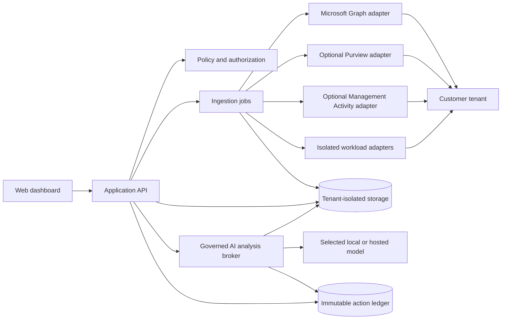

# Prism365

Prism365 is a community-built, privacy-conscious Microsoft 365 administration,
reporting, and auditing platform. It is an independent project: it is not affiliated
with, endorsed by, or derived from AdminDroid or Microsoft.

> **Status: pre-alpha.** The current repository is a runnable product shell with demo
> data, architecture boundaries, safety policy, and contribution workflow. It does not
> yet connect to a production Microsoft 365 tenant.

## Why this exists

Microsoft 365 administrators should be able to understand tenant health without buying
an opaque reporting suite or granting a tool more access than it needs. Prism365 aims
to provide:

- fast, accessible reporting for identity, audit, usage, and service health;
- transparent permission requests, with every permission tied to a feature;
- privacy-preserving defaults and tenant-controlled retention;
- explainable findings that cite the underlying evidence;
- safe administration workflows with preview, approval, and rollback where possible;
- a contributor experience that works well for humans and AI agents.

Prism365 does **not** treat activity logs, presence, message counts, or other telemetry
as proof of employee productivity or performance. Audit data is operational and security
evidence with known gaps—not a worker-scoring system.

## What runs today

- A polished responsive dashboard populated with clearly labelled demo data.
- A small Fastify API with health, dashboard, capability, and permission-catalog routes.
- Shared runtime contracts using Zod.
- A Microsoft Graph HTTP boundary with host allowlisting, read-only-by-default behavior,
  pagination, `Retry-After` handling, and code-owned global/GCC/GCC High/DoD/China profiles.
- A machine-readable source and permission catalog that records cloud, role, license, and
  tenant-service prerequisites for each feature.
- A policy package that blocks unsupported productivity claims and classifies findings.
- A provider-neutral AI analysis broker with explicit dataset grants, tenant-bound evidence,
  identifier/raw-record gates, citation validation, no write tools, and a disabled-by-default
  loopback Ollama adapter. No provider is configured in the demo.
- Automated formatting, tests, type checks, builds, dependency updates, and CodeQL.

## Quick start

Requirements: Node.js 24 or newer and npm 11 or newer.

```bash
npm install
npm run dev:api
```

In a second terminal:

```bash
npm run dev:web
```

Open `http://localhost:5173`. The API listens only on `127.0.0.1:8787` by default.

Useful checks:

```bash
npm run check
npm run build
```

## Product boundaries

The MVP is intentionally narrow and read-only:

1. Tenant connection and consent inventory.
2. Entra users and sign-in/audit summaries.
3. Microsoft 365 usage report summaries.
4. Evidence-backed findings and export.
5. Optional, read-only AI explanations through an administrator-selected provider.
6. No management writes until preview, authorization, audit, and approval controls exist.

Purview Audit search is a separate optional connector because it has separate licensing,
role, query, retention, and permission constraints. It is not silently bundled into the
basic Graph connection.

The deployment target is any supported Microsoft Entra **work or school** tenant whose
administrator grants the selected permissions and whose user/service principal, licenses,
tenant settings, and Microsoft cloud satisfy that feature's prerequisites. Personal Microsoft
accounts are not supported. Features degrade independently rather than demanding one broad
permission bundle.

See [Data sources](docs/DATA_SOURCES.md), [Compatibility](docs/COMPATIBILITY.md),
[Deployment requirements](docs/REQUIREMENTS.md), [Roadmap](docs/ROADMAP.md),
[Permissions](docs/PERMISSIONS.md), [AI integration](docs/AI_INTEGRATION.md), and
[Privacy principles](docs/PRIVACY.md) before proposing a connector or report.

## Architecture at a glance



The current scaffold implements the browser, API contract, policy core, safe Graph boundary,
and provider-neutral AI analysis boundary. Durable jobs, tenant-isolated persistence, a real
evidence reader, and provider adapters arrive after the connection flow.
See [Architecture](docs/ARCHITECTURE.md) for the target design.

## Permission philosophy

- Start with no tenant permissions.
- Ask for a feature pack only when an administrator enables that feature.
- Prefer delegated or resource-specific consent when it satisfies the use case.
- Keep read and write identities separate.
- Never use `Directory.ReadWrite.All` or similarly broad permissions as a convenience.
- Show the exact permission, data accessed, purpose, and behavior if denied.
- Re-check Microsoft documentation during implementation; permissions and availability
  can change.

The catalog includes separate read packs for directory, license inventory, service health,
audit, usage, security, and device data. Purview, the Management Activity feed, and Exchange
Online automation remain distinct connectors with their own prerequisites.

## Contributing

Start with [CONTRIBUTING.md](CONTRIBUTING.md). Humans and AI agents use the same issue,
review, test, privacy, and attribution standards. AI agents must additionally follow
[AGENTS.md](AGENTS.md) and the coordination board in [TASKS.md](TASKS.md).

Pre-alpha ownership and decision rules are in [GOVERNANCE.md](GOVERNANCE.md). Repository
owners should follow the [publishing checklist](docs/PUBLISHING.md) before making a public
GitHub claim.

Good first contributions include accessibility fixes, mock-data stories, contract tests,
permission documentation, and small read-only report adapters. Please do not submit bulk
generated reports or tenant write actions without an accepted design issue.

## Security

Do not open a public issue for a vulnerability or include tenant data, access tokens,
client secrets, directory object identifiers, or audit records in an issue. Follow
[SECURITY.md](SECURITY.md).

## License and trademarks

Prism365 is licensed under the [Apache License 2.0](LICENSE). Apache-2.0 is permissive
and includes an explicit patent license, which is useful for a broad contributor base.

“Microsoft,” “Microsoft 365,” “Entra,” “Graph,” and “Purview” are trademarks of
Microsoft Corporation. “AdminDroid” belongs to its respective owner. These names are
used only to describe interoperability or project inspiration; no endorsement is implied.
