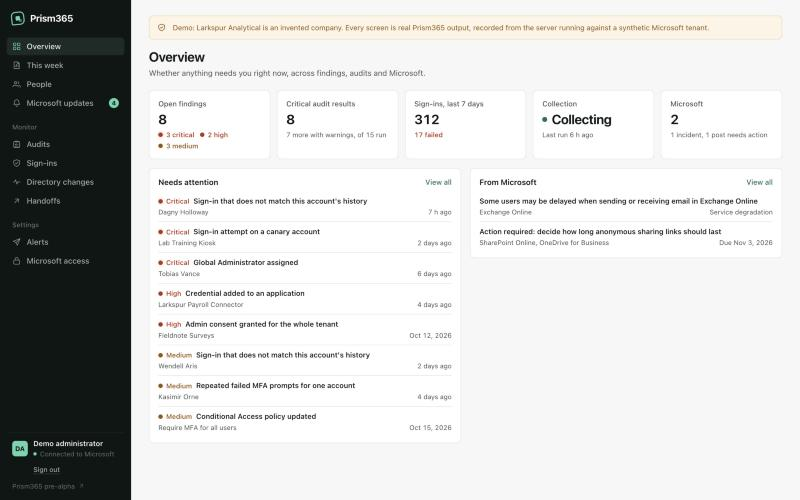
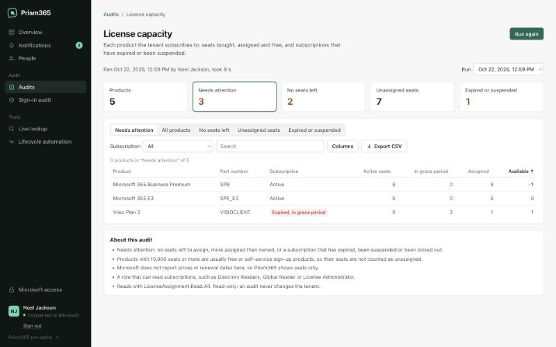

# Prism365

Read-only Microsoft 365 administration for one tenant, self-hosted. It watches every sign-in,
gives each account one page with everything about it, runs on-demand account and license audits,
and tracks Microsoft's own incidents and Message center posts.



[Try the demo](https://nullel.github.io/prism365/). It shows every screen on data recorded from
the real server running against an invented company, with no tenant and no backend
([how it is made](docs/DEMO.md)).

Prism365 is a personal project I use every day as an IT administrator. It is pre-alpha and
not affiliated with Microsoft.

## What it does

### Sign-in monitoring

Collects every interactive sign-in from Microsoft Graph, learns where
and on which devices each account normally signs in, and flags what breaks that: impossible
travel, password sprays, repeated MFA prompts, a success right after a run of failures. Each
finding carries its evidence and its limitations.

### People

One page per account: where they signed in from, with full addresses and devices,
the apps they use, their manager and licenses from the live directory, open findings, and every
stored sign-in. A one-click Have I Been Pwned lookup opens in the administrator's own browser.

### Audits

Checks you run when you need them: inactive accounts by days since the last
successful sign-in (7, 30, 60, 90, 120, 180 and 365 days, or never), licenses on disabled or
inactive accounts, MFA registration (admins without MFA, phone-only methods), guest accounts,
license capacity, Conditional Access policies (legacy authentication, MFA for administrators,
exclusions), risky users, managed devices, app consents (high-risk and unverified apps) and
Microsoft 365 app usage. Results are kept, filterable, sortable and exportable as CSV. Each audit
runs only when its own read pack is enabled, and says what it needs when it is not.



### Service health and notifications

Microsoft's incidents and advisories for the services the
tenant uses, and Message center posts with deadlines, retirements and major changes. Each change
is tracked as a revision with a plain note, and review state is kept apart from what Microsoft
says.

### Read-only, always

The Graph client refuses every write, and every permission Prism365 asks
for is tied to one feature.

### Prism365 and action tools

Prism365 sees; a separate tool acts. From an audit's results you export a handoff, the list of
accounts to act on with the reasons, for your offboarding or lifecycle tool. The receipt that
tool sends back is imported and shown on each person's page as the tool's report
([formats](docs/handoff.md)); Prism365 never calls the tool and shares no credentials with it.

## How it is built

TypeScript throughout: a Fastify API, a React and Vite front end, and zod contracts shared by
both. Node runs the server's TypeScript directly, so there is no server build step.

Some of the parts I care most about:

- Tenant data lives in PostgreSQL with forced row-level security on every table. Every runtime
  query is checked on PostgreSQL's own parse tree (libpg-query) against a per-call table
  allowlist and a function allowlist, so quoting or comments cannot sneak a statement past it.
- The Microsoft Graph boundary allows only the endpoints each permission pack declares, only
  read methods, no redirects, bounded response sizes and times, and honours `Retry-After`.
- Sign-in collection is built never to lose data silently. Two saved positions follow the log:
  one reads new sign-ins, the other re-reads an hour behind for records Microsoft publishes
  late. Windows shrink when Microsoft is slow or busy, a stopped run is detected and recovered,
  and anything that truly cannot be read becomes a finding instead of a hole.
- Collection runs on the administrator's own delegated session: server-side MSAL sign-in with
  PKCE, an allowlist of administrators, HttpOnly sessions and CSRF checks. It resumes on its own
  after a restart.
- Modules (sign-in audit, service health, Message center) declare their permissions, tables,
  retention and collectors, and run in a scheduler that owns credentials and storage.
- Every RED-class change (storage, auth, collection) went through adversarial review passes
  whose findings were reproduced with scripts before they were fixed. More than 330 automated
  tests, including PostgreSQL 17 suites.

## Run it

Requirements: Node.js 24 or newer and npm 11 or newer.

```bash
npm install
npm run demo
```

That builds the demo described above and serves it at `http://localhost:4173`.

To connect your own tenant, one command registers the Entra app, makes its certificate and
writes `.env`; it shows its plan and asks before changing anything:

```bash
npm run setup -- --tenant contoso.onmicrosoft.com
```

Then open the admin consent link it prints, and start the Docker install with
`scripts/docker-live.sh init` and `scripts/docker-live.sh up`. [Setup](docs/SETUP.md) covers
each step, the manual path, and what each feature needs.

## Documentation

[Setup](docs/SETUP.md), [Audits](docs/audits.md), [Handoffs](docs/handoff.md), [Sign-in audit](docs/modules/signins-audit.md),
[Service health](docs/modules/service-health.md), [Module runtime](docs/MODULES.md),
[Permissions](docs/PERMISSIONS.md), [Privacy](docs/PRIVACY.md), [Architecture](docs/ARCHITECTURE.md),
[Roadmap](docs/ROADMAP.md), and the decision records in [docs/decisions](docs/decisions).

## License

Apache License 2.0. "Microsoft", "Microsoft 365", "Entra" and "Graph" are trademarks of
Microsoft Corporation, used only to describe interoperability.
