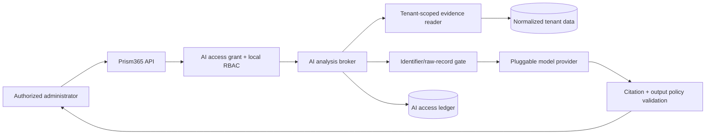

# Pluggable AI analysis

Prism365 supports a replaceable, read-only AI analysis layer. A tenant may connect a local,
tenant-hosted, or external model provider and explicitly grant it access to selected Prism365
datasets. The model receives bounded evidence bundles, not Microsoft credentials, database
credentials, unrestricted SQL, or direct Graph access.

The governing decision is [ADR-0004](decisions/0004-governed-ai-gateway.md).

## What “all data” means

An administrator can grant a provider every dataset that Prism365 currently knows about:

- findings, directory metadata, licenses, and service health;
- sign-ins and directory audits;
- usage reports and Conditional Access configuration;
- identity risk, Secure Score, Defender incidents, and managed devices;
- normalized configuration, Purview Audit, and Management Activity records.

There is deliberately no permanent `all` wildcard. “All” is a snapshot containing every
current dataset ID. A newly added connector remains unavailable to existing AI grants until an
administrator reviews and adds it. Prism365 cannot expose data it was not authorized to
collect, and content such as mail bodies, chats, files, calendars, or presence is not added
merely to make the AI broader.

Large datasets are retrieved in bounded, relevant evidence windows rather than copied into one
prompt. This avoids context truncation, reduces disclosure, and preserves citations and
coverage metadata.

## Architecture

The model provider has one operation: analyze structured evidence and return a structured,
cited explanation. It has no Prism365 tools, Graph tokens, database handle, export capability,
or management actions. A future tool or MCP surface is a separate security milestone and must
use the same authorization gateway; token passthrough is forbidden.

## Provider deployments

| Deployment | Example | Default data posture |
|---|---|---|
| Local | A model exposed on the same machine, such as a local Ollama server | Preferred for experimentation; verify host access and local model/storage security |
| Tenant-hosted | Model endpoint operated in the customer's cloud/account | Suitable when the tenant controls network, region, keys, and retention |
| External | Third-party hosted inference API | Disabled until an administrator explicitly allows external processing for that exact provider |

`@prism365/ai` defines the provider interface without requiring a vendor SDK. Provider
credentials are injected server-side from a secret service and never appear in tenant config,
prompts, the browser, logs, or the AI access ledger. Endpoints are operator-configured and
allowlisted; they are not taken from a chat question or tenant record.

The first concrete adapter calls Ollama's local `/api/chat` endpoint. It permits only an exact
loopback URL, requests non-streaming JSON-schema output at temperature zero, supplies no tools,
bounds request/response size and timeout, and returns provider-controlled failures as redacted
status errors. It is not enabled until a real tenant evidence reader and setup flow exist.

Potential adapters include Ollama-compatible local inference, Azure-hosted model endpoints,
and hosted APIs. Each adapter needs its own reviewed data-use statement, retention behavior,
regional availability, model/version policy, timeout, rate limit, cost controls, and deletion
story. A brand name alone is not a privacy guarantee.

## Tenant AI access grant

Every analysis requires a time-bounded grant containing:

- exact tenant, provider, allowed purposes, and dataset IDs;
- whether external processing is allowed;
- whether direct identifiers and raw records are allowed;
- maximum lookback period and evidence-record count;
- approving administrator, approval time, and expiration.

The administrator sees these choices before enablement. Direct identifiers are stored in a
separate evidence field and omitted by default. Raw records are blocked by default. The broker
rejects cross-tenant records, out-of-window evidence, duplicate evidence IDs, unauthorized
datasets, expired grants, invented citations, and prohibited workforce-performance claims.

The audit ledger records metadata such as actor, provider, datasets, record count, identifier
mode, and time. It does not record the question, evidence, answer, credentials, or prompt body
by default.

## Prompt injection and untrusted output

Microsoft records, configuration strings, user questions, and model output are all untrusted.
The gateway keeps instructions and evidence structurally separate, tells the provider that
evidence is data rather than instructions, and gives the model no action tools. These controls
reduce impact but cannot guarantee that a model follows instructions.

AI output must therefore:

- be runtime-validated and rendered as untrusted text/Markdown with safe links and HTML;
- cite evidence IDs that were actually supplied;
- show limitations, freshness, and coverage;
- pass deterministic policy checks before display or downstream use;
- never become SQL, a URL fetch, a permission change, or an admin action without a separate
  validated workflow and explicit human approval.

## Provider review checklist

Before enabling a real adapter, document and test:

1. who operates the endpoint and where processing/storage occurs;
2. whether prompts or outputs train models, enter abuse review, or persist as application state;
3. retention/deletion controls and whether stateless/no-store modes actually apply to the chosen
   endpoint and features;
4. authentication, secret rotation, TLS, private networking, egress allowlisting, and SSRF
   protection;
5. tenant/model rate limits, spend limits, timeouts, cancellation, and circuit breaking;
6. model/version pinning, schema conformance, citation integrity, and regression evaluations;
7. direct and indirect prompt-injection tests using synthetic evidence;
8. data residency, regulatory, contractual, incident-response, and subprocessor requirements.

Provider terms and behavior can change. Re-verify them at release and periodically thereafter.

## Current state

The provider interface, governed broker, schemas, policy checks, loopback Ollama adapter, and
synthetic tests exist. No production tenant evidence reader or configured provider is enabled
yet, and the API truthfully advertises `analysisEnabled: false`, `providerConfigured: false`,
and `writeToolsEnabled: false`.

## Primary references

- [NIST Generative AI Profile](https://www.nist.gov/publications/artificial-intelligence-risk-management-framework-generative-artificial-intelligence)
- [OWASP prompt-injection prevention guidance](https://cheatsheetseries.owasp.org/cheatsheets/LLM_Prompt_Injection_Prevention_Cheat_Sheet.html)
- [Ollama API and local endpoint documentation](https://docs.ollama.com/api/introduction)
- [Ollama structured outputs](https://docs.ollama.com/capabilities/structured-outputs)
- [Azure model data, privacy, and security](https://learn.microsoft.com/en-us/azure/ai-foundry/responsible-ai/openai/data-privacy)
- [OpenAI API data controls](https://developers.openai.com/api/docs/guides/your-data)
- [MCP security best practices](https://modelcontextprotocol.io/docs/2025-11-25/tutorials/security/security_best_practices)
