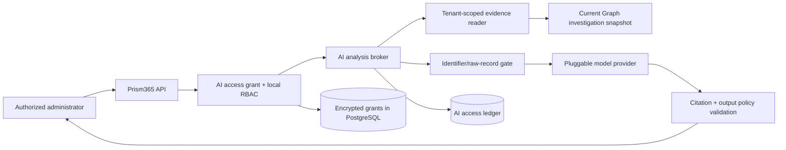

# Pluggable AI analysis

Prism365 defines a replaceable, read-only AI analysis layer. The current pilot integrates a local
Ollama provider with an authenticated user investigation and explicit dataset grants. Tenant-hosted
and external adapters remain future integrations. The model receives bounded evidence bundles,
not Microsoft credentials, database credentials, unrestricted SQL, or direct Graph access.

The governing decision is [ADR-0004](decisions/0004-governed-ai-gateway.md).

## What “all data” means

The grant contract names datasets explicitly. Its intended catalog includes:

- findings, directory metadata, licenses, and service health;
- sign-ins and directory audits;
- usage reports and Conditional Access configuration;
- identity risk, Secure Score, Defender incidents, and managed devices;
- normalized configuration, Purview Audit, and Management Activity records.

There is deliberately no permanent `all` wildcard. “All” is a snapshot containing every
current dataset ID. A newly added connector remains unavailable to existing AI grants until an
administrator reviews and adds it. Prism365 cannot expose data it was not authorized to
collect, and content such as mail bodies, chats, files, calendars, or presence is not added
merely to make the AI broader.

The current setup exposes only `directory`, `licenses`, and `signIns`, drawn from the selected
user investigation. Other catalog entries do not imply implemented collection or UI availability.

Large datasets are retrieved in bounded, relevant evidence windows rather than copied into one
prompt. This avoids context truncation, reduces disclosure, and preserves citations and
coverage metadata.

## Architecture

The model provider has one operation: analyze structured evidence and return a structured,
cited explanation. It has no Prism365 tools, Graph tokens, database handle, export capability,
or management actions. A future tool or MCP surface is a separate security milestone and must
use the same authorization gateway; token passthrough is forbidden.

## Provider deployments

| Deployment | Example | Default data posture |
|---|---|---|
| Local | A model exposed on the same machine, such as a local Ollama server | Preferred for experimentation; verify host access and local model/storage security |
| Tenant-hosted | Model endpoint operated in the customer's cloud/account | Suitable when the tenant controls network, region, keys, and retention |
| External | Third-party hosted inference API | Disabled until an administrator explicitly allows external processing for that exact provider |

`@prism365/ai` defines the provider interface without requiring a vendor SDK. The current local
adapter uses no provider credential. Future credential-bearing adapters must inject secrets on the
server and exclude them from prompts, browser state, logs, and the access ledger. Endpoints are
operator-configured and allowlisted; chat questions and tenant records cannot override them.

The first concrete adapter calls Ollama's local `/api/chat` endpoint. It permits only an exact
loopback URL, requests non-streaming JSON-schema output at temperature zero, supplies no tools,
bounds request/response size and timeout, rejects redirects, cancels stalled response reads, and
requires the returned model name to match the configured model. Provider failures are redacted.
Set `AI_LOCAL_MODEL` on a live server with Microsoft sign-in and encrypted PostgreSQL state to
make this pilot available. The browser cannot select an arbitrary provider endpoint. Matching a
model name does not establish an immutable model-artifact version.

Potential adapters include Ollama-compatible local inference, Azure-hosted model endpoints,
and hosted APIs. Each adapter needs its own reviewed data-use statement, retention behavior,
regional availability, model/version policy, timeout, rate limit, cost controls, and deletion
story. A brand name alone is not a privacy guarantee.

## Tenant AI access grant

Every analysis requires a time-bounded grant containing:

- exact tenant, provider, allowed purposes, and dataset IDs;
- whether external processing is allowed;
- whether direct identifiers and raw records are allowed;
- maximum lookback period and evidence-record count;
- approving administrator, approval time, and expiration.

The current UI lets an administrator select available datasets for a security-investigation grant.
It fixes the window at seven days, the evidence limit at 102 records, and expiration at one hour.
Direct identifiers, raw records, and external processing are disabled. Grants are encrypted and
stored under the authenticated tenant and actor; a DELETE grant route revokes access.

The broker accepts a server-derived actor and grant ID, loads the authoritative grant, and checks
the current actor authorization rather than trusting a browser-submitted grant. It rechecks both
immediately before provider disclosure. Direct identifiers occupy a separate evidence field and
are omitted by default. Even authorized raw inputs are reduced to reviewed scalar fields; the
current broker has no raw-body passthrough. The broker
rejects cross-tenant records, out-of-window evidence, duplicate evidence IDs, unauthorized
datasets, expired grants, invented citations, and prohibited workforce-performance claims.

Dataset-specific allowlists accept reviewed numbers, booleans, and enums. Arbitrary nested JSON,
source labels, and source limitation text are omitted. The `complete` boolean preserves license
and sign-in coverage; false adds a deterministic capped/partial-source limitation. Empty successful
sign-in windows are represented explicitly, while unavailable sources cannot be treated as empty
success. Opaque model citation IDs map back to authorized application evidence IDs.
Reviewed coverage and disclosure limitations are also appended to the displayed answer even if
the model omits them.

Questions are free text. By default, known evidence identifiers, emails, IPv4 addresses, and UUIDs
are redacted, but unknown personal names and other sensitive operator-typed text can remain. The
UI and provider limitations disclose this residual risk; this is not a zero-data-leak guarantee.

The durable audit ledger records grant approval/revocation and correlated authorized, completed,
or failed analysis events. The broker persists its authorized attempt before evidence-reader access
and provider disclosure, and refuses to send evidence if that append fails. Metadata includes actor,
provider, datasets, record count, identifier mode, and time. Questions, evidence, answers,
credentials, and prompt bodies are not stored in the ledger. An unavailable completion/failure
append leaves the already-persisted attempt available for investigation.

## Prompt injection and untrusted output

Microsoft records, configuration strings, user questions, and model output are all untrusted.
The gateway keeps instructions and evidence structurally separate, tells the provider that
evidence is data rather than instructions, and gives the model no action tools. These controls
reduce impact but cannot guarantee that a model follows instructions.

AI output must therefore:

- be runtime-validated and rendered as untrusted text/Markdown with safe links and HTML;
- cite evidence IDs that were actually supplied;
- show limitations, freshness, and coverage;
- pass deterministic policy checks before display or downstream use;
- never become SQL, a URL fetch, a permission change, or an admin action without a separate
  validated workflow and explicit human approval.

## Provider review checklist

Before enabling a real adapter, document and test:

1. who operates the endpoint and where processing/storage occurs;
2. whether prompts or outputs train models, enter abuse review, or persist as application state;
3. retention/deletion controls and whether stateless/no-store modes actually apply to the chosen
   endpoint and features;
4. authentication, secret rotation, TLS, private networking, egress allowlisting, and SSRF
   protection;
5. tenant/model rate limits, spend limits, timeouts, cancellation, and circuit breaking;
6. model/version pinning, schema conformance, citation integrity, and regression evaluations;
7. direct and indirect prompt-injection tests using synthetic evidence;
8. data residency, regulatory, contractual, incident-response, and subprocessor requirements.

Provider terms and behavior can change. Re-verify them at release and periodically thereafter.

## Current state

The API and UI integrate grant creation/revocation, bounded user-investigation evidence, the
governed broker, and optional local inference. Live AI requires authenticated Microsoft sessions,
`AI_LOCAL_MODEL`, and durable encrypted PostgreSQL storage; demo mode keeps it unavailable.
Write tools remain disabled. This first live-auth integration is a pilot that has not yet been
verified against an authorized Microsoft tenant or a real local model.

Evidence is collected from request-time Graph investigations, not a durable reporting warehouse.
Broader dataset collection, ingestion jobs, additional providers, provider cost/rate controls,
complete local-role policy, independent privacy/security review, and live conformance testing
remain outstanding. Synthetic tests prove boundaries and failure behavior, not universal Microsoft
license, role, cloud, or tenant compatibility.

## Primary references

- [NIST Generative AI Profile](https://www.nist.gov/publications/artificial-intelligence-risk-management-framework-generative-artificial-intelligence)
- [OWASP prompt-injection prevention guidance](https://cheatsheetseries.owasp.org/cheatsheets/LLM_Prompt_Injection_Prevention_Cheat_Sheet.html)
- [Ollama API and local endpoint documentation](https://docs.ollama.com/api/introduction)
- [Ollama structured outputs](https://docs.ollama.com/capabilities/structured-outputs)
- [Azure model data, privacy, and security](https://learn.microsoft.com/en-us/azure/ai-foundry/responsible-ai/openai/data-privacy)
- [OpenAI API data controls](https://developers.openai.com/api/docs/guides/your-data)
- [MCP security best practices](https://modelcontextprotocol.io/docs/2025-11-25/tutorials/security/security_best_practices)
